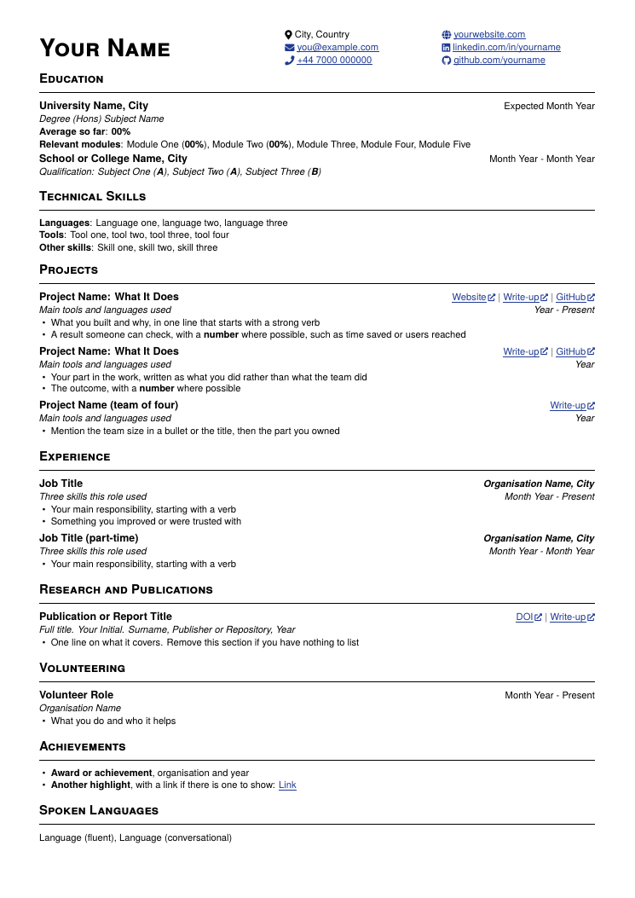
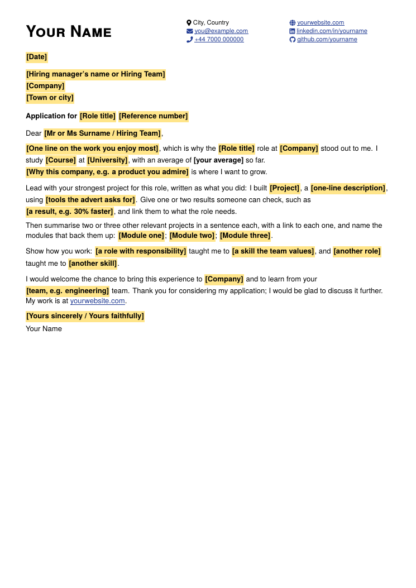

# latex-cv

A clean LaTeX CV and a one-page cover letter in a matching style, written so applicant tracking systems read every word.
Open the `.tex` files, replace the example text with your own and compile.

| CV | Cover letter |
| --- | --- |
|  |  |

## What is in it

| File | What it is |
| --- | --- |
| [`cv.tex`](cv.tex) | The CV: education, skills, projects, experience, publications, volunteering, achievements and languages |
| [`cover-letter.tex`](cover-letter.tex) | A one-page letter with the same header and highlighted placeholders to fill in |
| [`cv.pdf`](cv.pdf), [`cover-letter.pdf`](cover-letter.pdf) | The compiled examples |

## Build it

Both files need **XeLaTeX** (or LuaLaTeX), because they load fonts through `fontspec`. Every font and package they use
ships with TeX Live, so nothing extra has to be installed.

- **Overleaf:** upload the `.tex` file, then open Menu, set Compiler to XeLaTeX and recompile.
- **Tectonic:** `tectonic cv.tex` downloads what it needs on the first run.
- **TeX Live or MacTeX:** `latexmk -xelatex cv.tex`

> [!IMPORTANT]
> pdfLaTeX will not compile these files. If Overleaf shows a `fontspec` error, the compiler is still set to pdfLaTeX.

## Fill it in

- **Header:** replace the name, location, email, phone and the three links at the top. The phone line can be deleted.
- **Entries:** each entry has a bold title with links or the organisation on the right, then an italic line with the
  tools or skills and the dates, then bullets. Copy a whole entry to add another.
- **Bullets:** start with a verb, keep to one or two lines and give a number someone could check.
- **Cover letter:** every part to change is **in square brackets on a highlight**. Search for `\ph{` to find them all,
  then replace each one with plain text.
- **Metadata:** set your name in `pdfauthor`, `pdfcreator` and `pdftitle` near the top so the PDF's properties carry
  it.

## Reading by recruitment systems

- The contact icons are marked with empty `ActualText`, so text extraction skips them instead of returning stray
  symbols.
- Ligatures are switched off, so words such as "office" are not read as "o ice".
- Hyphenation is off, so no word is split across two lines.
- Section names are standard (Education, Experience, Projects, Skills), which parsers recognise.

Check a finished PDF by copying all of its text into a plain text editor: what appears there is what a parser reads.

## Licence

[MIT](LICENSE). See also the [changelog](CHANGELOG.md), [accessibility notes](ACCESSIBILITY.md),
[contributing guide](CONTRIBUTING.md) and [support](SUPPORT.md).
